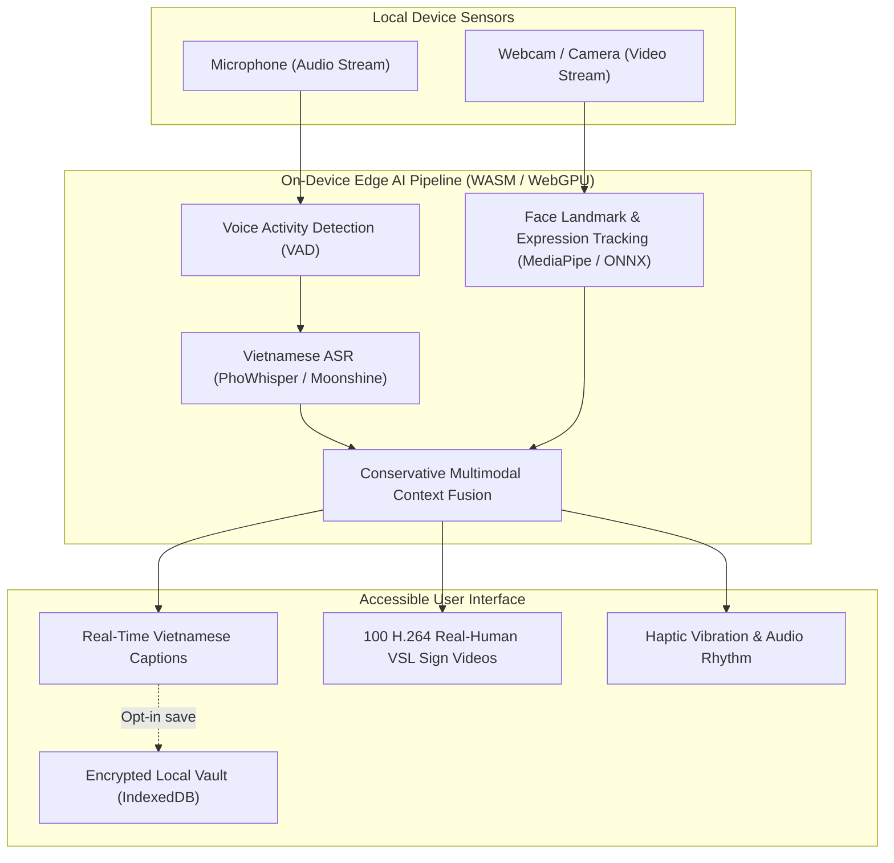

# SignEmo — AI-Powered On-Device Accessible Communication

<p align="center">
  
</p>

<p align="center">
  <strong>Bridging Communication for the Deaf & Hard-of-Hearing with Real-Human Sign Language & Observable Multimodal AI</strong>
</p>

<p align="center">
  <a href="#features"></a>
  <a href="#vsl-dataset"></a>
  <a href="#tech-stack"></a>
  <a href="#tech-stack"></a>
  <a href="#tech-stack"></a>
  <a href="#license"></a>
</p>

---

## 📖 Overview

**SignEmo** is a privacy-first, on-device Progressive Web App (PWA) designed to empower the Deaf and Hard-of-Hearing community in everyday conversations, medical encounters, and public interactions. 

Unlike traditional cloud-dependent assistive tools, SignEmo processes **100% of audio and video locally** on the user's device using WebAssembly and WebGPU. It combines real-time Vietnamese speech-to-text, 100 authentic Vietnamese Sign Language (VSL) real-human demonstration videos, observable facial expression indicators, and sensory haptic vibration feedback.

---

## 🌟 Key Highlights

### 1. 🤟 100 Authentic Real-Human Vietnamese Sign Language (VSL) Videos
- Curated from the verified **ViSignLanguage-Video** dataset (PTIT AI Challenge, CC-BY-4.0).
- Encoded in modern, web-optimized **H.264 (avc1/yuv420p)** for instantaneous playback across mobile and desktop browsers (iOS Safari, Android Chrome, Edge, desktop).
- **Smart Intent Matching**: Users don't need to recite long sentences verbatim. Speaking keywords like *"Cảm ơn"*, *"Xin chào"*, *"Bác sĩ"*, *"Sốt"*, or *"Uống thuốc"* triggers the corresponding sign video automatically.
- **Quick Phrase Catalogue**: Searchable catalogue with categorised chips (Communication, Health & Medical, Daily Living) for deaf users to explore and practice.

### 2. 🔒 Strict On-Device Privacy (Zero Cloud Leakage)
- Microphone audio and webcam frames **never leave the user's browser**.
- No surveillance, no remote audio recording, and no third-party data tracking.
- Local conversation history is stored exclusively in an encrypted, opt-in on-device vault (AES-GCM with PBKDF2 key derivation).

### 3. ⚡ Edge AI & Multimodal Synthesis
- **Vietnamese ASR Pipeline**: Fast on-device speech recognition via PhoWhisper-tiny and experimental Moonshine streaming WebAssembly.
- **Observable Face Analysis**: Low-latency facial landmarking and expression tracking with fallback to CPU compatible mode on older hardware.
- **Haptic Rhythm Feedback**: Translates speech cadence and conversational cues into tactile vibration patterns for deaf users.

### 4. 📱 Offline-First PWA & Mobile Native Readiness
- Comprehensive Service Worker precaching via Workbox.
- Works reliably in poor connectivity or airplane mode after first asset warmup.
- Packaged for Android via Trusted Web Activity (TWA / PWABuilder).

---

## 🏛️ System Architecture



---

## 📂 Project Structure

```text
├── public/                     # Static web assets
│   ├── signs/                  # 100 H.264 authentic VSL video phrases
│   ├── demo/                   # Demo media & animations
│   ├── _headers                # Cloudflare Pages / Netlify security headers (COOP/COEP)
│   ├── _redirects              # SPA routing rules
│   └── manifest.webmanifest    # PWA configuration manifest
├── src/
│   ├── app/                    # Application shell, routing & state composition
│   ├── domain/                 # Pure business logic (ASR, sign phrases, fusion, audit)
│   │   └── sign/               # VSL catalogue, playback queue, and asset verification
│   ├── features/               # UI pages and components
│   │   ├── conversation/       # Real-time captions, sign video card, quick phrase picker
│   │   ├── overview/           # AI preparation & warmup landing page
│   │   ├── practice/           # Haptic rhythm training playground
│   │   └── history/            # Encrypted local conversation vault
│   └── infrastructure/         # External adapters (WebAssembly, Audio, Camera, Storage)
├── docker/                     # Production Dockerfile and Nginx security configuration
├── doc/                        # Specifications, technical notes, and verification audits
├── scripts/                    # Automation, asset preparation, and benchmark tools
├── tests/                      # Automated Vitest integration and unit test suites
└── vercel.json                 # Vercel deployment configuration with COOP/COEP headers
```

---

## 🚀 Getting Started

### Prerequisites
- **Node.js**: `>= 22.12` (recommended `v24.x`)
- **npm**: `>= 10.x`
- Modern browser with WebAssembly & Web Audio support (Chrome, Edge, Safari, Firefox).

### 1. Local Development

```bash
# 1. Install dependencies
npm ci

# 2. Download and verify initial AI model checkpoints
npm run assets:prepare
npm run assets:conversation

# 3. Start local development server (Vite with HMR)
npm run dev
```

Open `http://localhost:5173` in your browser.

### 2. Production Build & Local Preview

```bash
# Typecheck, bundle and build PWA assets
npm run build

# Preview production build locally
npm run preview
```

### 3. Docker Deployment (Recommended)

Run the full, isolated production container equipped with Nginx, HTTP security headers, and cross-origin isolation:

```bash
# Build and start container in detached mode
docker compose up -d --build

# View container status
docker compose ps
```

Visit `http://localhost:8080` (or `http://localhost:8095` for local media test profile).

---

## 🌐 Go-Live & Cloud Hosting

SignEmo requires **Cross-Origin-Opener-Policy (`same-origin`)** and **Cross-Origin-Embedder-Policy (`require-corp`)** HTTP headers to enable multi-threaded WebAssembly / SharedArrayBuffer for on-device inference.

### Option A: Hugging Face Spaces (100% Free Docker Hosting)
1. Create a new Space on [Hugging Face](https://huggingface.co/new-space).
2. Select **Docker (Blank)** SDK.
3. Push the repository to the Space Git remote. Hugging Face automatically provisions 2 vCPU, 16 GB RAM, and a free HTTPS endpoint.

### Option B: Vercel / Cloudflare Pages
- Pre-configured [`vercel.json`](vercel.json) and [`public/_headers`](public/_headers) are included.
- Connect your GitHub repository to Vercel or Cloudflare Pages for continuous deployment with unlimited CDN caching.

---

## 📱 Building the Android App

SignEmo is designed as a Trusted Web Activity (TWA) Progressive Web App:

1. **Via PWABuilder (Instant No-Code APK)**:
   - Navigate to [PWABuilder.com](https://www.pwabuilder.com/).
   - Enter your public HTTPS URL (e.g. from Vercel or Cloudflare).
   - Generate and download the signed `.apk` file for testing or `.aab` for Google Play Store.
   - *Any subsequent web update automatically syncs to all installed Android apps.*

2. **Via Capacitor (Native Android Studio Project)**:
   ```bash
   npm install @capacitor/core @capacitor/cli @capacitor/android
   npx cap init SignEmo com.signemo.app --web-dir=dist
   npm run build
   npx cap add android
   npx cap open android
   ```

---

## 🧪 Testing & Verification

Run the full verification suite (Vitest + Typecheck + Boundaries):

```bash
# Run automated test suites
npm test

# Run complete gatekeeper checks
npm run check
```

---

## ⚖️ Ethics, Privacy & Responsible AI

- **Observable Expressions Only**: SignEmo does not claim to decode inner emotional truth or intent. All visual cues represent observable physical facial movements and speech prosody, explicitly phrased as assistive suggestions.
- **Privacy Boundaries**: No video feed, audio recording, face landmark data, or private user transcripts are ever transmitted to remote telemetry servers.
- **Deaf Community Centered**: VSL video references reflect regional sign conventions and must be validated in partnership with native Deaf communicators.

---

## 📄 License & Attribution

- **Codebase**: Licensed under the [MIT License](LICENSE).
- **VSL Sign Language Video Dataset**: Curated from `namwu/ViSignLanguage-Video` (PTIT AI Challenge), licensed under [Creative Commons Attribution 4.0 International (CC-BY-4.0)](https://creativecommons.org/licenses/by/4.0/).
- Developed for the **OU Startup & Innovation Challenge**.
