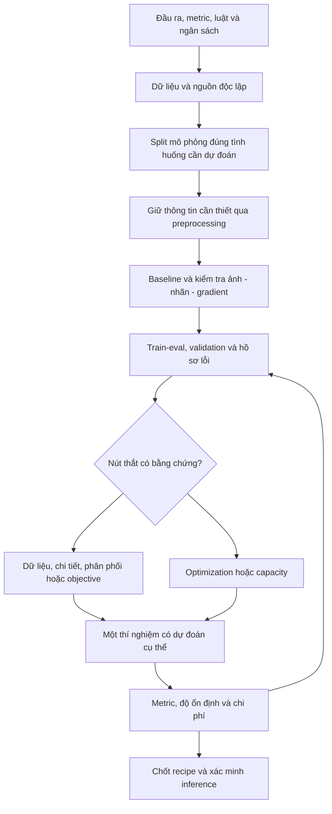

# Framework suy luận để xây dựng và tối ưu pipeline Computer Vision

Ngày: 17/10/2026. Tài liệu thực hành cho bài thi và dự án CV, từ classification đến detection, segmentation, OCR và video. Các khoảng hyperparameter và danh sách model bên dưới là **điểm khởi đầu để thử**, không phải quy luật chọn model tối ưu theo số ảnh.

Một recipe đầy đủ gồm: **cách đánh giá + cách đưa thông tin vào model + kiến trúc + objective + optimization + decision rule + ngân sách**. Backbone chỉ là một biến trong đó.

## 0. Ba điều cần hiểu trước: train 100%, lớp thiểu số và SOTA

**Train accuracy gần 100% = model xử lý rất tốt các mẫu đã học.** Nó chưa cho biết khả năng nhận diện ảnh mới từ nguồn khác. Số hiển thị cũng có thể đã làm tròn. Trước khi kết luận, đánh giá checkpoint cố định trên train không augmentation và xem từng lớp.

**Accuracy cao có thể che lỗi lớp ít mẫu**, vì ảnh của lớp đông đóng góp nhiều vào tỷ lệ đúng tổng. Tuy nhiên, chỉ đoán lớp đông không thể tạo accuracy cao trong mọi dataset: với GTSRB của bạn, lớp train đông nhất chỉ chiếm 5,80%. Model đạt gần 100% train rõ ràng đã học phân biệt nhiều lớp. Điểm yếu validation lớp 16/34 phải xem cả ánh sáng, che khuất và nguồn độc lập, ngoài số mẫu.

**SOTA chỉ có nghĩa sau khi xác định task + metric + split + luật dữ liệu.** Không lấy accuracy trên official test GTSRB trừ Macro-F1 validation split riêng. Bảng mốc công bố và mức xác minh nằm trong [mục 11 của bản đánh giá](01_DANH_GIA_NOTEBOOK.md#11-sota-của-bài-này-là-bao-nhiêu).

Nếu chỉ nhớ một cách làm: **model sai ở nhóm nào → nhóm đó khác train ở đâu → thay đổi nào kiểm tra được nguyên nhân ấy → kết quả có lặp lại không?**

## 1. Thứ tự suy nghĩ nên dùng

**Hiểu đầu ra → xác định thông tin quyết định nhãn → kiểm tra nguồn dữ liệu/split → tạo baseline đáng tin → phân tích lỗi → chọn thí nghiệm phân biệt giả thuyết → xác nhận mức tăng → hoàn thiện inference.**



Đừng hỏi “model nào mạnh nhất?” quá sớm. Hỏi: **“Trong điều kiện này, điều gì đang giới hạn kết quả, và phép thử rẻ nhất nào phân biệt được các nguyên nhân?”**

## 2. Viết hợp đồng bài toán trước khi chọn kiến trúc

Điền một trang ngắn:

| Câu hỏi | Nó quyết định điều gì? |
|---|---|
| Một sample là ảnh, patch, video, người hay phiên chụp? | Unit dự đoán và group split |
| Output là một nhãn, nhiều nhãn, box, mask, chuỗi hay vector? | Head, loss, decoding |
| Metric chính xác là gì, có lớp cố định/ignore label không? | Checkpoint và cách tính score |
| Chi phí FP và FN có khác nhau không? | Sampling, loss hoặc threshold |
| Dự đoán cho nguồn đã thấy hay nguồn/địa điểm/thời điểm mới? | Validation protocol |
| Có cho pretrained, external data, pseudo-label, test-time adaptation không? | Không gian phương pháp hợp lệ |
| GPU, RAM, tổng thời gian, inference deadline? | Cỡ input/model và số trial |
| Artifact cuối là CSV, model hay service? | Pipeline inference phải hoàn thiện đến đâu |

Ví dụ GTSRB trong notebook: một ảnh → một trong 43 nhãn; Macro-F1; train từ đầu; một GPU; đồng thời làm NLP. Một classifier nhỏ là baseline có lý. Detector thêm box không giải quyết nhu cầu đã được crop sẵn.

Phân biệt **khởi tạo ngẫu nhiên toàn bộ model** với **xây pipeline mới dùng pretrained**. Hai nghĩa của “build từ đầu” dẫn đến lựa chọn khác nhau; luật đề phải rõ.

## 3. Phân tích dữ liệu theo sáu trục

### 3.1. Số lượng và mức đa dạng độc lập

Ghi cả `N_images`, `N_groups`, `N_classes`, samples/group và groups/class. Một triệu frame của ít video không tương đương một triệu tình huống độc lập. Lớp có 300 ảnh từ 10 nguồn có thể khó tổng quát hơn lớp có 150 ảnh từ 150 nguồn.

Khi thiếu dữ liệu, câu hỏi đúng là thiếu **biến thiên nào**: vật thể, kiểu chữ, camera, góc nhìn, ánh sáng, bề mặt, địa điểm hay nhãn? Oversampling một ảnh không tạo ra nguồn mới.

### 3.2. Thông tin không gian

Ghi native width/height, aspect ratio, kích thước đối tượng và **chi tiết nhỏ nhất làm đổi nhãn**. Ví dụ: toàn bộ biển báo có thể rộng 40 pixel nhưng nét phân biệt hai chữ số chỉ vài pixel.

Với resize đẳng hướng tỷ lệ `a`, chi tiết rộng `d` pixel thành khoảng `a*d` pixel. Sau backbone có tổng stride `s`, phạm vi đó tương ứng khoảng `a*d/s` ô feature. Đây là chỉ báo mức nén không gian; không phải định lý rằng dưới một ô thì chắc chắn mất nhãn, vì convolution có thể mã hóa tín hiệu trước downsample.

Ví dụ giả định: vết xước rộng 3 pixel trong ảnh 512, giảm toàn ảnh xuống 128 thì chỉ còn khoảng 0,75 pixel bề rộng. Nên xem patch/ROI hoặc giữ resolution trước khi thử model lớn hơn.

### 3.3. Phân phối

Tách các vấn đề:

- **Class imbalance:** tần suất nhãn lệch.
- **Domain shift:** camera, ánh sáng, nền hoặc nguồn khác nhau.
- **Temporal shift:** dữ liệu tương lai khác dữ liệu cũ.
- **Label noise:** nhãn sai hoặc guideline không nhất quán.
- **Selection bias:** ảnh có mặt trong train khác ảnh thực tế cần dự đoán.
- **Near duplicates:** train và validation có thể gần như cùng một quan sát.

Mỗi vấn đề cần phép thử khác. Reweight classes không tự sửa domain shift; augmentation không tự sửa label mapping sai.

Ví dụ thực tế từ dataset của bạn: lớp 16 chỉ có 240 ảnh train, nhưng validation còn có nhiều ảnh rất tối và rất sáng. Chọn weighted CE chỉ dựa vào “240 là ít” bỏ sót một giả thuyết quan trọng về phân phối điều kiện ảnh. Lớp 34 có ảnh mũi tên bị che một phần, nên số mẫu không diễn tả đầy đủ độ khó.

### 3.4. Modality và dtype

Kiểm tra range, bit depth, units, channel semantics, missing values, layout và annotation. `uint8`, RGB và “classification” lần lượt nói về **lưu trữ**, **loại tín hiệu**, **đầu ra**; đừng gộp chúng thành một khái niệm data type.

### 3.5. Chất lượng nhãn

Xem mẫu dễ, khó và ngẫu nhiên từng lớp; đọc label guideline; kiểm tra class ID lệch 0/1, box chuẩn hóa hay pixel, mask có ignore value, chuỗi OCR có chuẩn Unicode không. Có thể ưu tiên xem ảnh có loss cao kéo dài, nhưng không tự xóa chúng: đó cũng có thể là ca hiếm quan trọng.

### 3.6. Ngân sách và hệ thống

Đo thời gian đọc ảnh, augment, forward/backward, validation, ghi checkpoint và inference. Batch time nhỏ nhưng dataset preparation quá lâu vẫn làm mất lượt thử. Chọn model phù hợp với **số vòng phản hồi chất lượng có thể thực hiện**.

## 4. Chọn validation trước khi search

| Cấu trúc dữ liệu | Split khởi đầu |
|---|---|
| Ảnh khá độc lập, cùng domain | Stratified holdout |
| Frame theo video/track, nhiều ảnh một vật thể/người/phiên | Group split; cân bằng lớp nếu khả thi |
| Dự đoán tương lai | Time split, tránh dùng tương lai để fit preprocessing |
| Nguồn/camera/site mới | Holdout domain hoặc group theo nguồn |
| Rất ít nguồn độc lập | Group cross-validation nếu đủ ngân sách; báo độ bất định |
| Cuộc thi cung cấp validation chuẩn | Giữ protocol đó; thêm kiểm tra nội bộ từ train khi cần |

`StratifiedGroupKFold` cố giữ cân bằng lớp và không giao group, nhưng không bảo đảm cân bằng hoàn hảo khi group bị ràng buộc. [scikit-learn documentation](https://scikit-learn.org/stable/modules/generated/sklearn.model_selection.StratifiedGroupKFold.html).

Fit scaler, normalization, feature selector và mọi thành phần học từ dữ liệu trên training fold tương ứng. Augmentation/synthetic sinh từ mẫu train phải ở phía train sau split.

Đánh giá tăng điểm bằng prediction ghép cặp trên cùng sample. Nếu có track IDs, bootstrap theo group, có xét các lớp thiếu trong resample; bootstrap từng ảnh có thể đánh giá thấp uncertainty khi các frame tương quan. Độ dao động giữa seed và uncertainty do validation là hai nguồn khác nhau.

Khi một lớp validation chỉ có một hoặc hai nguồn độc lập, việc nó đạt F1=1 chưa chứng minh model hiểu toàn bộ lớp đó. Cũng không tối ưu lặp đi lặp lại vào public leaderboard rồi gọi đó là bằng chứng tổng quát.

## 5. Chọn preprocessing theo thông tin cần giữ

### 5.1. Theo hình học và kích thước

| Dữ liệu / dấu hiệu | Pipeline khởi đầu | Điều cần tránh |
|---|---|---|
| Ảnh 28–64, đối tượng đã crop, chi tiết rõ | Input gần native size; CNN stem stride 1 | Stem 7×7 stride 2 + maxpool dùng máy móc |
| Ảnh nhỏ, tỷ lệ hình chứa thông tin | So sánh square resize với aspect-preserving padding | Mặc định padding luôn tốt hơn warp |
| Ảnh vừa/lớn, vật thể chiếm phần lớn ảnh | Resize vừa ngân sách, crop bảo toàn object | Crop làm nhãn sai nhưng vẫn giữ target |
| Ảnh lớn, nhãn phụ thuộc vùng nhỏ | ROI, patch/tiling và aggregation phù hợp | Downsample toàn ảnh làm biến mất vùng cần học |
| Nhiều vật thể nhỏ | Detection với multiscale/FPN; thử tiling | Chỉ tăng classifier head |
| Ranh giới/pixel quan trọng | Segmentation encoder–decoder, skip features | Chấm chỉ accuracy pixel khi background áp đảo |
| Chữ dài, tỷ lệ rộng/cao thay đổi | Resize theo chiều cao, pad/bucket chiều rộng | Ép tất cả chuỗi thành hình vuông |

Đừng resize nối tiếp 48 → 64 để so sánh với 48: lấy cả hai từ nguồn gốc. Cache cần chứa mọi yếu tố làm đổi ảnh như size, interpolation, crop và phiên bản dữ liệu.

### 5.2. Theo modality

| Loại input | Hợp đồng preprocessing | Model family khởi đầu |
|---|---|---|
| RGB | Thứ tự RGB/BGR, range, mean/std, màu có ý nghĩa không | CNN/residual CNN; pretrained encoder nếu được phép |
| Grayscale | Giữ dynamic range; 1 channel hoặc adapter 3 channel | CNN 1-channel từ đầu; encoder có adapter khi transfer |
| 16-bit/ảnh cường độ đặc thù | Giữ độ sâu bit; clipping/window/range có căn cứ theo dữ liệu | 2D/3D CNN phù hợp cấu trúc input |
| Multispectral | Channel meanings, scale từng band, missing bands | CNN sửa input channels, spectral-spatial model khi cần |
| Depth | Đơn vị, invalid mask, range vật lý | Depth encoder; fusion nếu có thêm RGB |
| Video | FPS, sampling clip, thứ tự thời gian, split theo video | Frame CNN + temporal pooling/1D temporal model; 3D model khi cần motion |
| Volume | Spacing, trục, orientation, ngân sách patch | 2D/2,5D/3D encoder–decoder tùy dữ liệu |
| Point cloud | Units, coordinate frame, sampling, density | Point-based hoặc voxel-based network |

Preprocessing intensity phụ thuộc dữ liệu; không có công thức normalize ImageNet dùng chung mọi modality. Với pretrained model, kiểm tra đúng transforms của bộ weights đã chọn. [Torchvision models and weights](https://docs.pytorch.org/vision/stable/models.html).

Mask class IDs thường resize nearest-neighbor; ảnh và annotation phải cùng phép hình học. Depth continuous cần xử lý vùng invalid trước nội suy; không áp dụng rule của mask class IDs một cách máy móc.

### 5.3. Chọn augmentation bằng invariance

Hỏi: **“Biến đổi này có thể xảy ra mà nhãn vẫn đúng không?”**

- Biển báo mũi tên: flip có thể đổi nghĩa.
- OCR: xoay/flip có thể tạo chữ khác hoặc không hợp lệ.
- Defect orientation: rotation chỉ hợp lệ nếu định nghĩa nhãn không phụ thuộc hướng.
- Màu quyết định class: hue jitter mạnh có thể phá nhãn.
- Detection/segmentation: cập nhật box/mask đồng bộ.
- Video: color transform độc lập quá mạnh từng frame có thể tạo motion giả.

Xem contact sheet sau augmentation. Nếu người đọc không còn xác định nhãn đáng tin cậy, augmentation có thể đang ép model học target sai.

## 6. Chọn backbone theo chế độ học và cấu trúc tín hiệu

### 6.1. Ít dữ liệu và pretrained được phép

Bắt đầu bằng frozen encoder + linear head hoặc fine-tune model vừa. Đây là đối chứng để đo chất lượng representation và lỗi nhãn. Sau đó unfreeze theo budget; dùng LR backbone nhỏ hơn head khi thích hợp, và kiểm tra domain mismatch.

Model lớn pretrained không đương nhiên overfit hơn model nhỏ từ đầu. Lịch sử pretraining là một phần năng lực của model; không thể chọn theo parameter count và số ảnh đích đơn thuần.

### 6.2. Train từ đầu, ảnh nhỏ/vừa, ngân sách giới hạn

Bắt đầu bằng CNN nhỏ/MiniResNet hoặc residual CNN có stem hợp resolution. Tune input, LR và augmentation trước khi thay nhiều họ kiến trúc. Thử tăng **width hoặc depth từng hướng**, có đối chứng đủ hội tụ.

Một họ WideResNet là lựa chọn để nghiên cứu tradeoff depth–width, không phải bảng tra “dưới X ảnh dùng WRN”. [Wide Residual Networks](https://arxiv.org/abs/1605.07146).

### 6.3. Dữ liệu đa dạng, yêu cầu ngữ cảnh phức tạp, compute đủ

Có thể so sánh CNN hiện đại, hierarchical transformer hoặc ViT với training recipe phù hợp. Bản ViT gốc cho thấy vai trò của pretraining quy mô lớn khi transfer; không suy ra mọi Transformer đều cần cùng một ngưỡng dữ liệu hoặc đều thua CNN trên tập nhỏ. [ViT paper](https://arxiv.org/abs/2010.11929).

### 6.4. Output yêu cầu cấu trúc riêng

| Output / cấu trúc | Baseline có cơ sở | Khi nên tăng độ phức tạp |
|---|---|---|
| Một class cho ảnh crop | CNN + GAP + linear | Lỗi cho thấy thiếu chi tiết/capacity/ngữ cảnh |
| Nhiều class độc lập | Encoder + K logits, sigmoid | Cần mô hình quan hệ nhãn hoặc calibration tốt hơn |
| Box nhiều đối tượng | Detector có implementation sẵn và train recipe phù hợp | Lỗi theo kích thước, occlusion, scale |
| Mask semantic | U-Net hoặc encoder–decoder phù hợp | Context xa, multiscale hoặc boundary còn kém |
| Mask từng instance | Instance segmentation model | Nhiều đối tượng chạm nhau không tách được bằng semantic mask |
| Chuỗi OCR | CNN/sequence encoder + CTC, hoặc encoder–decoder | Lexicon, alignment, độ dài/kiểu chữ yêu cầu |
| Retrieval / nhận dạng theo embedding | Encoder + metric-learning head/loss | Mining, margin và sampling có bằng chứng cần thiết |
| Anomaly với rất ít nhãn lỗi | Đối chứng supervised nếu có đủ nhãn; one-class/feature distance khi phù hợp | Khả năng phủ loại lỗi mới và false alarm |
| Motion quyết định nhãn | Temporal model trên clips | Frame baseline bỏ sót động học thật |

U-Net ghép đường nén context với đường giải mã để định vị chi tiết, nên là một baseline segmentation có lý do cấu trúc. [U-Net paper](https://arxiv.org/abs/1505.04597).

Với video, luôn thử frame baseline để biết có cần motion thật hay đang học background. Với anomaly, không được giả định một reconstruction model chắc chắn cho lỗi tái tạo lớn ở mọi loại bất thường.

### 6.5. Ma trận chọn recipe theo đặc điểm dữ liệu

Đây là các **ứng viên khởi đầu**, không phải lựa chọn thắng đã được đo trên mọi dataset. Xem đồng thời số nguồn độc lập, thông tin nhãn và luật pretrained; không quyết định chỉ bằng H×W hay N.

| Tổ hợp điều kiện | Backbone/pipeline khởi đầu | Những biến cần tune trước |
|---|---|---|
| Ảnh nhỏ đã crop, train từ đầu, dữ liệu tương quan theo track | MiniResNet stem 3×3 stride 1, GAP; group validation | 48/64 tùy native size, augmentation theo điều kiện, LR |
| Ảnh nhỏ nhưng nhiều nguồn đa dạng, chi tiết phức tạp | Residual CNN sâu/rộng hơn hoặc WRN nhỏ | Depth/width dưới cùng budget, resolution, regularization |
| Ít nhãn, pretrained được phép, ảnh tự nhiên | Frozen encoder + head; rồi fine-tune ResNet/ConvNeXt hoặc encoder phù hợp | Domain match, pretrained transforms, LR backbone/head |
| Nhiều nhãn và compute, cần context toàn ảnh | So sánh CNN/hierarchical Transformer/ViT với recipe tương xứng | Input/patch scale, schedule, regularization, compute |
| Ảnh lớn, dấu hiệu rất nhỏ, chỉ có image labels | Patch/ROI + aggregation; MIL nếu nhiều patch không mang nhãn ảnh | Patch size, sampling và pooling; label validity |
| Vị trí/ranh giới quyết định output | Detector/FPN hoặc U-Net/encoder–decoder theo annotation | Object scale, tiling, loss/matching hoặc mask resize |
| Class lệch và ít nguồn lớp hiếm | Baseline encoder phù hợp input; giữ metric theo lớp | Class weights **hoặc** sampler; dữ liệu/augmentation theo nguồn |
| Class không quá lệch nhưng domain thay đổi mạnh | Model phù hợp input, validation theo domain | Preprocessing consistency, domain augmentation, nguồn bổ sung |
| Nhãn nhiễu hoặc nhập nhằng | Baseline vừa, lưu loss/margin để audit nhãn | Label guideline, smoothing/robust objective nếu có bằng chứng |
| Phải chạy trên thiết bị nhỏ | CNN gọn, MobileNet hoặc student được distill hợp lệ | Latency/RAM trên thiết bị thật, size, quantization khi triển khai |

Với grayscale/multispectral/volume, thay hợp đồng input theo mục 5.2; không mặc định copy pipeline RGB. Với ít nhãn và pretrained bị cấm, chuyển sang CNN nhỏ và tăng dữ liệu đa dạng hợp lệ, thay vì dùng pretrained rồi gọi đó là “train từ đầu”.

## 7. Nối target → loss → metric → decision rule

| Target | Objective khởi đầu | Metric/decision phải kiểm tra |
|---|---|---|
| Một class trong K lớp | CrossEntropy trên logits, label integer | Accuracy/Macro-F1; argmax baseline |
| Multi-label | BCEWithLogits, K targets | Micro/macro F1, AP; thresholds cần chọn bằng validation |
| Binary classification lệch lớp | BCEWithLogits hoặc CE 2 lớp | PR-AUC/F1/recall theo đề; không mặc định threshold 0,5 tối ưu |
| Semantic segmentation | CE/BCE; thêm Dice nếu phù hợp | IoU/Dice theo lớp, ignore index, empty-mask convention |
| Detection | Loss classification + localization của model | mAP, matching/IoU, NMS và scale bins |
| Regression | MSE/L1/Huber tùy penalty | Sai số gốc, outliers, transform target |
| OCR không có alignment ký tự | CTC nếu kiến trúc/target đáp ứng | CER/WER, blank token, chiều dài sequence và decoding |
| Embedding | Contrastive/triplet/proxy loss theo thiết kế | Recall@K, verification threshold, class-disjoint protocol |

**CrossEntropy không tối ưu trực tiếp Macro-F1.** Weighted CE, sampler và logit adjustment là các cách thay đổi áp lực học/decision boundary; phải đo bằng metric cuối cùng. Đừng suy ra lớp lệch là phải dùng focal loss. Focal có thể tăng chú ý vào nhãn sai hoặc ca mơ hồ; chỉ cân nhắc khi easy negatives là nút thắt có bằng chứng.

Phân biệt:

1. **Representation:** ảnh có được mã hóa đủ để phân biệt không?
2. **Calibration:** xác suất có phản ánh tần suất đúng không?
3. **Decision:** chọn nhãn/ngưỡng theo metric thế nào?

Một scalar temperature dương không đổi thứ tự logits nên không đổi argmax single-model classification. Threshold có ích cho binary/multilabel; bài multiclass không có một threshold chung tương đương để tự động tối ưu Macro-F1.

## 8. Training: tune biến nào trước?

### 8.1. Trước lượt train dài

Chạy vài batch để xác minh shape, dtype, range, mapping, finite loss và gradient. Overfit một batch nhỏ không augmentation: nếu không học được, tìm lỗi trước khi thêm regularization hoặc model lớn. Baseline ngẫu nhiên CE khoảng `log(K)` chỉ là kiểm tra thô; logits khởi tạo không đều có thể lệch.

Lưu config thực sự được dùng, không chỉ config dự kiến. In model parameter count, thiết bị và version môi trường.

### 8.2. Thứ tự search thực dụng

1. **Correctness + split + metric.** Những lỗi này có thể làm mọi trial phía sau vô nghĩa.
2. **Input/ROI/augmentation hợp lệ.** Bảo đảm model thấy đúng thông tin.
3. **LR và chiều dài schedule.** Có recipe hội tụ trong budget.
4. **Regularization.** Weight decay, smoothing, dropout/mixup theo lỗi.
5. **Objective/sampling.** Chỉ khi per-class analysis cho thấy cần.
6. **Architecture.** So sánh model khi có lý do và recipe tương xứng.
7. **Ensemble/TTA.** Chỉ giữ khi mức tăng đáng chi phí inference.

Đây là thứ tự mặc định; nếu nhãn là mask mà model đang dùng classification head, phải sửa kiến trúc ngay.

### 8.3. Phạm vi khởi đầu cho CNN nhỏ train từ đầu

| Biến | Điểm thử gợi ý | Cách suy luận |
|---|---|---|
| AdamW LR | `3e-4, 1e-3, 3e-3` | Search thô theo log scale, không thử mọi tổ hợp |
| Weight decay | `1e-4, 5e-4, 1e-3` | Xét cùng LR, số update và parameter groups |
| Batch | `64,128,256` nếu phù hợp | Đo throughput, BN và số update, không chỉ VRAM |
| Warmup | Ngắn so với tổng steps, có thể thử 2–5% | Có cần ổn định early training không? |
| Label smoothing | `0,0.03,0.05` | Theo dõi recall lớp khó và sự tự tin |
| Dropout | Giữ baseline nhỏ, thử có/không | Không chồng quá nhiều regularization |
| Input size | Hai mức có lý do từ native detail | So sánh chất lượng lẫn thời gian |

Các số trên không áp dụng nguyên xi cho pretrained fine-tuning, Transformer, detection hoặc mọi batch size. SGD+momentum cũng là đối chứng CNN hợp lệ nếu có thời gian tune; không có optimizer thắng chung.

Gradient accumulation thay đổi effective optimizer batch nhưng **không tự biến BN microbatch thành batch lớn**. Tăng batch làm giảm số update/epoch; giữ nguyên epoch và LR chưa phải recipe tương đương. Weight decay cũng có tác động tích lũy khác theo LR/schedule/update count.

Với model rất nhỏ hoặc epoch ngắn, CPU augmentation/launch overhead có thể chiếm nhiều thời gian. AMP, channels-last hoặc compile phải đo sau warmup và tính cả startup; compile không tự có lời cho lượt chạy ngắn.

### 8.4. Khi train đã gần 100% thì tune gì?

Đầu tiên xác nhận đó là train-eval của checkpoint hay accuracy trong training loop. Sau đó nhìn validation:

| Train-eval | Validation | Ưu tiên suy luận |
|---|---|---|
| Cao ở hầu hết lớp | Cao ở hầu hết lớp, còn ít lỗi cụ thể | Sửa nhóm lỗi, quyết định ensemble/TTA và chi phí |
| Cao ở lớp hiếm | Recall lớp hiếm thấp | Kiểm tra nguồn/điều kiện ảnh và decision boundary; weighting là một candidate |
| Thấp riêng lớp hiếm | Cũng thấp riêng lớp hiếm | Exposure/sampling, objective, label quality và optimization |
| Cao toàn bộ | Thấp ở domain mới | Split/domain shift, augmentation và đa dạng nguồn |
| Cao toàn bộ | Dao động mạnh theo epoch | LR/BN/checkpoint/seed và độ ít nguồn validation |

Train loss gần 0 không yêu cầu dừng train ngay: LR decay có thể tiếp tục cải thiện validation, như notebook hiện tại. Cũng không chứng minh train lâu hơn sẽ tăng điểm. Quyết định theo validation và deadline; model lớn hơn phải chứng minh chất lượng representation cho ảnh mới tốt hơn.

## 9. Đọc learning curve và hồ sơ lỗi để chọn hành động

| Quan sát | Giả thuyết cần phân biệt | Phép thử ưu tiên |
|---|---|---|
| Không overfit nổi một batch sạch | Lỗi pipeline, LR, gradient, target | Kiểm tra mapping/range, gradient và optimizer |
| Train-eval thấp, val thấp | Optimization chưa tốt hoặc thiếu capacity/thông tin | Kiểm tra LR và input trước; rồi width/depth |
| Train-eval cao, val thấp | Thiếu đa dạng, shift, overfit, split | Group/domain analysis, augmentation hợp lệ, regularization |
| Val dao động, train loss thấp | LR, BN, metric ít nguồn, stochasticity | Theo dõi per-class, thử LR thấp/EMA, đo nhiều seed |
| Lỗi tập trung ảnh rất nhỏ | Chi tiết thiếu hoặc input geometry | Resolution/ROI/stem trước backbone lớn |
| Lỗi tập trung một camera | Domain shortcut hoặc shift | Holdout camera, stats theo nguồn, augmentation phù hợp |
| Recall lớp hiếm thấp, precision cao | Decision bias hoặc representation chưa đủ | Xem margin/confusion, thử weighting hoặc objective có kiểm soát |
| Lớp hiếm precision thấp | FP từ lớp khác, noise hoặc quá bù imbalance | Xem nguồn FP; không tự tăng weight tiếp |
| Train/val gần hoàn hảo quá sớm | Có thể bài dễ, cũng có thể leakage | Kiểm tra nguồn, duplicates, label-derived filenames |
| Test/public lệch validation | Sampling shift, inference mismatch hoặc val overfit | Kiểm tra preprocessing/order và phân phối hợp lệ |

Accuracy train trong lúc augmentation/mixup/dropout không tương đương train-eval. Loss train weighted/smoothed cũng không so trực tiếp về trị số với validation CE thường. Trước khi giải thích đường cong, phải biết mỗi đường đang đo gì.

## 10. Những chiến lược nâng cao: dùng theo điều kiện

| Kỹ thuật | Hợp khi | Chi phí/rủi ro cần kiểm soát |
|---|---|---|
| EMA | Training dao động, cần candidate ổn định | Decay theo steps, BN buffers, checkpoint policy |
| SWA | Có schedule và trajectory phù hợp để average | BN recalibration; không average weights bất kỳ |
| SAM | Muốn thử nghiệm generalization và đủ compute | Thêm pass, BN và budget |
| Progressive resizing | Chi tiết cuối cần input lớn, giai đoạn đầu có thể rẻ hơn | Tính cả fine-tune cuối; stats/geometry và BN thay đổi |
| STN | Sai chủ yếu do biến đổi hình học | Identity init, sampling ngoài ảnh, interpolation blur |
| Hard-example mining | Có tập ca khó hợp lệ và nhãn đáng tin | Có thể tập trung vào noise; giữ mẫu bình thường |
| Distillation | Có teacher hợp lệ tốt hơn, cần student nhẹ | Teacher cũng phải tuân thủ luật pretrained/data |
| Self-supervised learning | Có nhiều ảnh không nhãn được phép và đủ thời gian | Pretrain không miễn phí; phải đánh giá downstream |
| Pseudo-labeling | Unlabeled pool được phép, teacher đủ tốt | Confirmation bias, lệch class và leakage |
| Ensemble | Các candidate sửa lỗi khác nhau | Lưu logits đúng ID, inference RAM/time |
| TTA | Biến đổi bảo toàn nhãn, lỗi vị trí/scale nhỏ | Có thể mất chi tiết; tăng inference |

Chọn một kỹ thuật vì **nó xử lý cơ chế lỗi đang thấy**. Tên mới hoặc mức điểm cao trên dataset khác không thay cho ablation của bài mình.

## 11. Framework quyết định synthetic data

Trước khi sinh, trả lời: **“Dữ liệu thật thiếu chiều biến thiên nào mà phép sinh này có thể bổ sung đúng?”**

| Dữ liệu đang thiếu | Hướng thử | Cách đánh giá |
|---|---|---|
| Blur/noise/ánh sáng của camera | Degradation có tham số và mức độ thực tế | Real validation chia theo chất lượng |
| Góc nhìn/scale | Geometry hợp nhãn, renderer nếu có tài nguyên hợp lệ | Real ảnh góc khó, không chỉ synthetic val |
| Nền đa dạng | Background substitution khi mask đúng | Model có bớt phụ thuộc nền không? |
| Biến thể ký hiệu/chữ | Procedural từ quy tắc đúng và tài nguyên cho phép | Kiểm tra nhãn, font/domain và readability |
| Class hiếm nhưng mẫu gốc ít | Augmentation có mục tiêu; tìm nguồn thật nếu được phép | Gain có lặp trên nguồn độc lập không? |
| Nhãn bất thường khó thu thập | Simulation với giả định rõ | Real anomalies chưa thấy và false positives |

Thiết kế thử nghiệm:

1. Real-only làm đối chứng.
2. Thêm synthetic theo vài tỷ lệ nhỏ có kiểm soát.
3. Ghi rõ tổng updates, số lần thấy mỗi ảnh thật và compute.
4. Validation real độc lập; synthetic không rò nguồn từ validation.
5. Kiểm tra theo class/domain, không chỉ average score.
6. Có thể thử giai đoạn cuối real-only nếu synthetic tạo domain gap.

Một triệu ảnh sinh từ vài template có thể chỉ dạy model nhận template. Dữ liệu sinh không đáng giá theo số lượng file; nó đáng giá khi phủ được biến thiên liên quan đến dữ liệu cần dự đoán.

## 12. Thiết kế thí nghiệm như giải quyết giả thuyết

Mỗi trial ghi trước:

```text
Quan sát: Recall lớp 16 thấp; ảnh validation lớp này có kích thước gốc khác train.
Giả thuyết: Resize 48 làm mất chi tiết ở một số ảnh.
Can thiệp: Chỉ tăng input 48 -> 64, đọc trực tiếp từ nguồn gốc.
Giữ cố định: Split, seed đối chứng, backbone, loss, augmentation recipe.
Dự đoán: Cải thiện nhóm lỗi cần chi tiết, không chỉ tăng điểm toàn cục.
Đo: Macro-F1, class 16/34 P-R-F1, ảnh sai theo size, thời gian/epoch.
Giới hạn: 64 tốn compute hơn; cần ghi số update và mức hội tụ.
Quyết định: Giữ nếu lợi ích đáng thời gian và xác nhận được; nếu không, cập nhật giả thuyết.
```

Giai đoạn chẩn đoán thường đổi một yếu tố để biết nguyên nhân. Khi đã có bằng chứng về tương tác, có thể thử một gói thay đổi và gọi đúng là thử recipe, không gán toàn bộ gain cho riêng backbone.

### 12.1. Search theo nhiều mức tài nguyên

Sàng lọc bằng run ngắn để loại cấu hình sai hoặc quá chậm; không loại model học chậm chỉ vì early score thấp. Candidate tốt cần đủ schedule cuối. Xác nhận top ít cấu hình bằng nhiều seed nếu budget cho phép.

Đánh giá hai trục:

- **Chất lượng recipe:** khi các cấu hình được train đủ theo kế hoạch.
- **Chất lượng trong deadline:** điểm tốt nhất có thể hoàn thành kể cả inference.

Chọn candidate trên biên hiệu quả: không có phương án khác vừa điểm cao hơn vừa chi phí thấp hơn. Một mức tăng 0,1 điểm phần trăm mất thêm một giờ có thể không hợp cuộc thi còn task khác.

### 12.2. Mẫu bảng experiment

| Run | Giả thuyết | Config chính | Seed | Steps/phút | Best F1 | Lớp/domain yếu | Inference | Quyết định |
|---|---|---|---|---|---|---|---|---|
| A | Baseline | 48, CE, mini residual CNN | 2026 | Ghi thực tế | 0,975795 | 16/34 | Chưa đo | Đối chứng |
| B | Imbalance làm giảm recall | 48, weighted CE | 2026 | Ghi thực tế | 0,975492 | Chưa đủ report | Chưa đo | Chưa chứng minh hơn A |
| C | Mất chi tiết ở resize | 64, CE, cùng backbone | Cặp seed đối chứng | Chưa chạy | Chưa có | Cần đo | Cần đo | Giả thuyết |

## 13. Ba ví dụ suy luận từ dữ liệu tới strategy

### Ví dụ A — Biển báo nhỏ, train từ đầu

Thông tin quyết định là màu, viền và ký hiệu nhỏ. Nguồn độc lập là track. Chọn classification CNN có stem giữ resolution, RGB, augmentation hình học nhẹ, CE baseline và Macro-F1. Sau baseline, lỗi lớp 16/34 dẫn đến hồ sơ lỗi, 64/padding/degradation có mục tiêu. Model lớn chỉ trở thành ưu tiên khi có bằng chứng representation hiện tại thiếu.

### Ví dụ B — 2.000 ảnh grayscale 256×256, năm loại lỗi bề mặt

Giả sử vết xước rất mảnh và ảnh theo các lô sản xuất. Split theo lô/vật thể; giữ intensity phù hợp; xem 128 có làm mất nét không. Bắt đầu CNN nhỏ ở resolution đủ hoặc patch aggregation. Patch label không tự bằng image label: ảnh dương có nhiều patch âm, nên cần vị trí lỗi hoặc cơ chế multiple-instance learning phù hợp. Nếu nhãn cần diện tích/rìa lỗi, segmentation có thể hợp hơn image classification. Ít ảnh không đồng nghĩa giảm input xuống 32.

### Ví dụ C — Nhiều frame, ít video, nhãn là hành động

Split theo video/người/phiên tùy mục tiêu. Làm frame CNN baseline và clip baseline. Nếu frame đã đạt cao, kiểm tra background shortcut; nếu nhãn phụ thuộc thứ tự động tác, temporal pooling không thứ tự có thể thiếu. Chọn độ dài clip và sampling theo khoảng thời gian hành động, không chỉ số frame. Augment nhất quán trong clip. Một video test không được có frame anh em nằm trong train.

## 14. Phiếu dùng ngay khi gặp bài mới

```text
1. Output / metric / luật:
2. Sample unit / independent group / mục tiêu generalization:
3. N_images / N_groups / N_classes / min groups per class:
4. Native size / object size / chi tiết phân biệt nhỏ nhất:
5. Modality / dtype / range / channels / annotation convention:
6. Imbalance / blur / noise / label quality / domain shift:
7. Split và các thành phần chỉ được fit trên train:
8. Baseline: preprocess -> encoder -> head -> loss -> decision:
9. LR / batch / steps / scheduler / budget:
10. Debug: batch nhỏ, gradient, model reload, inference order:
11. Ba nhóm lỗi lớn nhất và metric liên quan:
12. Giả thuyết ưu tiên / một phép thử / kết quả dự đoán:
13. Mức tăng / độ bất định / chi phí / quyết định:
14. Artifact cuối / config / preprocessing / ID order / deadline:
```

Cách ghi nhớ: **giữ đúng thông tin, đánh giá đúng sự tổng quát, tìm đúng nút thắt, rồi dùng compute để kiểm chứng.** Không có bảng `số ảnh + resolution → model tối ưu` dùng chung mọi bài; có một quy trình giúp loại bỏ lựa chọn thiếu cơ sở và tiến tới recipe tốt trong ngân sách cụ thể.

## 15. Đọc SOTA để lấy ý tưởng có thể kiểm chứng

Trước khi chọn một model từ paper, ghi thành hàng so sánh:

```text
Task / số lớp / metric / train-validation-test / nhóm độc lập
Pretrained / external data / synthetic / test adaptation
Input size / single model hay ensemble / train compute / inference compute
Mean ± std hay best seed / mã nguồn / checkpoint / protocol chọn model
```

Một phương pháp có accuracy công bố cao có thể dùng nhiều dữ liệu hơn, ensemble nhiều model hoặc chỉ phân loại vài nhóm biển. Điều học được là **cơ chế tạo lợi ích**: căn chỉnh hình học, giữ chi tiết, đa dạng ánh sáng, representation hoặc bổ sung lỗi. Mang cơ chế đó vào ablation có luật và budget giống bài mình.

Với bài GTSRB hiện tại, [bản đánh giá cập nhật](01_DANH_GIA_NOTEBOOK.md) tách mốc công bố khỏi điểm split mô phỏng. Chưa có SOTA đã xác minh cho đúng split và Macro-F1 của đề. Không gắn tên “SOTA architecture” cho candidate chưa train lại.

## 16. Áp dụng framework thành recipe cụ thể cho notebook của bạn

| Thành phần | Đối chứng đã có | Lượt thử kế tiếp | Candidate sau khi có bằng chứng |
|---|---|---|---|
| Input | RGB 48, square resize | RGB 64, cùng interpolation | Padding nếu geometry sai; giữ size nguồn |
| Backbone | MiniResNet width32, `(1,1,1,1)` | Giữ nguyên | Width32 `(2,2,2,2)` hoặc WRN-16-4 |
| Loss | CE / weighted CE | CE | Weighting/sampling nếu per-class analysis ủng hộ |
| Augmentation | Affine + ColorJitter nhẹ | Giữ nguyên để tách tác động size | Gamma có mục tiêu; degradation/occlusion nhẹ kiểm tra riêng |
| Optimization | AdamW 1e-3, WD5e-4, 30 epochs | Giữ recipe nếu budget đủ | LR5e-4 hoặc EMA, từng phép thử |
| Validation | Macro-F1 + accuracy | Thêm 43-class P/R/F1 và logits | Slice theo brightness/size, seed mới |
| Hoàn thiện | Checkpoint A có reload assertion | Xuất đúng public/private CSV | Ensemble candidate sửa lỗi bổ sung |

**Suy luận:** train gần 100% cho biết baseline đã có khả năng học train rất tốt; 48/69 lỗi thuộc lớp 16/34 chỉ ra nơi cần phân tích. Ảnh thật cho thấy biến thiên ánh sáng và che ký hiệu đáng kiểm tra. Vì thế đi từ size/condition → ổn định → representation là một kế hoạch có cơ sở. Những bước này vẫn cần train xác nhận, không phải cam kết đạt một mức điểm.

Trong một bài mới, thay “lớp 16/34” bằng nhóm lỗi có ảnh hưởng lớn nhất tới metric của bài ấy, rồi lặp lại cùng cách suy luận.
